# Lusot evaluation report (synthetic test data)

Synthetic test data for the harness's own tests. These are not Lusot's results.

## Reported first

Rules §7's three headline figures, for the configuration that ships and then for the other.

| Configuration | Underestimation | Passability agreement | Coverage |
|---|---|---|---|
| Landmark plus geometry (ships) | 1 of 5 (20.0%) | 5 of 5 (100.0%) | 6 of 8 (75.0%) |
| Landmark alone | 3 of 5 (60.0%) | 4 of 5 (80.0%) | 6 of 8 (75.0%) |

## Release gate

Rules §8's targets and guards, each with the value found. Geometry stays only if Set A underestimation doesn't rise and both guards hold, and inches show only if geometry stays and Set B meets its three targets.

Self-check: off (decided 2026-10-29, MS3). It is off in this evaluation: MS3b's ablation was dropped, so no development ablation exists to turn it on (eval/rules.md §8).

| Check | Found | Target | Passed |
|---|---|---|---|
| Set A underestimation | 1 of 5 (20.0%) with geometry, 3 of 5 (60.0%) without | no rise in the rate or the count | yes |
| Set A coverage (guard) | no change: 6 of 8 (75.0%) with geometry, 6 of 8 (75.0%) without | a fall of at most 10 points | yes |
| Set A passability agreement (guard) | a rise of 20.0 points: 5 of 5 (100.0%) with geometry, 4 of 5 (80.0%) without | a fall of at most 5 points | yes |
| Set B median depth error | 0.75 in (n = 7) | at most 3 in | yes |
| Set B wheels measured | 7 of 8 (87.5%) | at least 70% | yes |
| Set B envelope coverage | 4 of 7 (57.1%) | at least 80% | no |

**Decision:** Geometry stays in the level path, so landmark plus geometry ships. Inches aren't shown.

Reasons:

- Set B's envelope coverage is 4 of 7 (57.1%), below the 80% required.

## Set A: every metric

Each configuration's Set A figures over the photos that rules §9 keeps (rules §7). The level figures and kappa are over answered photos whose alert gave a level, and passability agreement over answered photos whose alert stated a class.

| Metric | Landmark alone | Landmark plus geometry |
|---|---|---|
| Photos scored | n = 8 | n = 8 |
| Coverage | 6 of 8 (75.0%) | 6 of 8 (75.0%) |
| Refused (can't tell) | 1 of 8 (12.5%) | 1 of 8 (12.5%) |
| Refused: too_dark | 1 of 8 (12.5%) | 1 of 8 (12.5%) |
| Processing failed | 1 of 8 (12.5%) | 1 of 8 (12.5%) |
| Processing failed: model_error | 1 of 8 (12.5%) | 1 of 8 (12.5%) |
| Underestimation | 3 of 5 (60.0%) | 1 of 5 (20.0%) |
| Overestimation | 1 of 5 (20.0%) | 1 of 5 (20.0%) |
| Level agreement, exact | 1 of 5 (20.0%) | 3 of 5 (60.0%) |
| Level agreement, within one level | 4 of 5 (80.0%) | 4 of 5 (80.0%) |
| Passability agreement | 4 of 5 (80.0%) | 5 of 5 (100.0%) |
| Weighted kappa (quadratic) | 0.80 (n = 5) | 0.88 (n = 5) |
| "No flood seen" readings | 1 of 8 (12.5%) | 1 of 8 (12.5%) |
| Floor readings ("at least" a level) | 1 of 8 (12.5%) | 1 of 8 (12.5%) |

## Baseline

The baseline gives every photo the same answers: the level knee and the class NPLV. Both come from run.json.

Each configuration comes first, then the baseline on the same answered rows. Exact agreement is shown, not compared.

| Answers | Exact (shown, not compared) | Within one level | Underestimation | Passability agreement | NPLV photos caught | NPATV photos caught |
|---|---|---|---|---|---|---|
| Landmark alone | 1 of 5 (20.0%) | 4 of 5 (80.0%) | 3 of 5 (60.0%) | 4 of 5 (80.0%) | 2 of 2 (100.0%) | 2 of 2 (100.0%) |
| Baseline, same rows | 2 of 5 (40.0%) | 3 of 5 (60.0%) | 2 of 5 (40.0%) | 2 of 5 (40.0%) | 2 of 2 (100.0%) | 2 of 2 (100.0%) |
| Landmark plus geometry | 3 of 5 (60.0%) | 4 of 5 (80.0%) | 1 of 5 (20.0%) | 5 of 5 (100.0%) | 2 of 2 (100.0%) | 2 of 2 (100.0%) |
| Baseline, same rows | 2 of 5 (40.0%) | 3 of 5 (60.0%) | 2 of 5 (40.0%) | 2 of 5 (40.0%) | 2 of 2 (100.0%) | 2 of 2 (100.0%) |

**Landmark alone**

- The baseline's underestimation is lower: 2 of 5 (40.0%) against 3 of 5 (60.0%).

## By the alert's level

Each configuration's Set A photos by the level the alert gave: the photos kept, those answered, and how many of those Lusot read exactly, within one level and below the alert's level. A level with 5 or more photos also shows the three as shares of its answered photos.

**Landmark alone**

| The alert's level | Photos | Answered | Exact | Within one level | Underestimated |
|---|---|---|---|---|---|
| gutter | n = 1 | 0 | 0 | 0 | 0 |
| half_knee | n = 1 | 1 | 0 | 0 | 1 |
| knee | n = 2 | 2 | 1 | 2 | 0 |
| tire | n = 1 | 1 | 0 | 1 | 1 |
| waist | n = 1 | 0 | 0 | 0 | 0 |
| chest | n = 1 | 1 | 0 | 1 | 1 |

**Landmark plus geometry**

| The alert's level | Photos | Answered | Exact | Within one level | Underestimated |
|---|---|---|---|---|---|
| gutter | n = 1 | 0 | 0 | 0 | 0 |
| half_knee | n = 1 | 1 | 0 | 0 | 1 |
| knee | n = 2 | 2 | 1 | 2 | 0 |
| tire | n = 1 | 1 | 1 | 1 | 0 |
| waist | n = 1 | 0 | 0 | 0 | 0 |
| chest | n = 1 | 1 | 1 | 1 | 0 |

## Set A: level matrices

One matrix for each configuration, over the answered photos whose alert gave a level: the alert's level down the side, Lusot's across. Each chart's table lists its non-empty cells, since GitHub shows a chart without its tooltips.



| The alert's level | Lusot's level | Photos |
|---|---|---|
| half_knee | no flood seen | 1 |
| knee | knee | 1 |
| knee | tire | 1 |
| tire | knee | 1 |
| chest | waist | 1 |



| The alert's level | Lusot's level | Photos |
|---|---|---|
| half_knee | no flood seen | 1 |
| knee | knee | 1 |
| knee | tire | 1 |
| tire | tire | 1 |
| chest | chest | 1 |

## Landmark agreement

Muse Spark's landmark against our M8 label for the same box (C415), over the Set A photos kept that Muse Spark answered, Lusot's refusals included. Every configuration shares Muse Spark's answer, so this is counted once.

| Reference | Agreement with M8 |
|---|---|
| Wheel | 1 of 3 (33.3%) |
| Vehicle body | 2 of 2 (100.0%) |
| Person | 0 of 2 (0.0%) |
| All | 3 of 7 (42.9%) |

Boxes that Muse Spark's answer skipped, which count as disagreements: 1 of 7 (14.3%). M8 labels that matched no box, which are left out: n = 1.

## A-neg: flood-free photos

The A-neg photos are openly licensed Wikimedia Commons photos (CC0, public domain or CC BY). Flood-free photos that got a level instead of "no flood seen" or a refusal, over the A-neg photos kept. A processing failure counts in the n, never as a false flood.

| Metric | Landmark alone | Landmark plus geometry |
|---|---|---|
| False flood rate | 1 of 4 (25.0%) | 0 of 4 (0.0%) |
| False flood rate, wet surface | 0 of 2 (0.0%) | 0 of 2 (0.0%) |
| False flood rate, dry surface | 1 of 2 (50.0%) | 0 of 2 (0.0%) |
| "No flood seen" | 2 of 4 (50.0%) | 2 of 4 (50.0%) |
| Refused (can't tell) | 1 of 4 (25.0%) | 1 of 4 (25.0%) |
| Processing failed | 0 of 4 (0.0%) | 1 of 4 (25.0%) |

## Correct refusals

The quality subset: the Set A and A-neg photos kept that were marked dark or blurry before the run (C414). A refusal is correct here, and a processing failure is not a refusal.

| Metric | Landmark alone | Landmark plus geometry |
|---|---|---|
| Correct refusals | 1 of 2 (50.0%) | 1 of 2 (50.0%) |
| Refused: too_dark | 1 of 2 (50.0%) | 1 of 2 (50.0%) |
| Answered | 0 of 2 (0.0%) | 0 of 2 (0.0%) |
| Processing failed | 1 of 2 (50.0%) | 1 of 2 (50.0%) |

## Subsets

Each subset marked before the run (C414), then the photos whose alert gave tire or deeper (W6).

**Landmark alone**

| Subset | Photos | Coverage | Underestimation | Passability agreement |
|---|---|---|---|---|
| moving | n = 1 | 1 of 1 (100.0%) | 0 of 1 (0.0%) | 0 of 0 (undefined) |
| reflection | n = 1 | 1 of 1 (100.0%) | 1 of 1 (100.0%) | 1 of 1 (100.0%) |
| splash | n = 1 | 1 of 1 (100.0%) | 1 of 1 (100.0%) | 0 of 1 (0.0%) |
| tire or deeper, by the alert | n = 3 | 2 of 3 (66.7%) | 2 of 2 (100.0%) | 1 of 2 (50.0%) |

**Landmark plus geometry**

| Subset | Photos | Coverage | Underestimation | Passability agreement |
|---|---|---|---|---|
| moving | n = 1 | 1 of 1 (100.0%) | 0 of 1 (0.0%) | 0 of 0 (undefined) |
| reflection | n = 1 | 1 of 1 (100.0%) | 0 of 1 (0.0%) | 1 of 1 (100.0%) |
| splash | n = 1 | 1 of 1 (100.0%) | 0 of 1 (0.0%) | 1 of 1 (100.0%) |
| tire or deeper, by the alert | n = 3 | 2 of 3 (66.7%) | 0 of 2 (0.0%) | 2 of 2 (100.0%) |

## Set B

Only the geometry variant counts for the release gate. Each variant's figures come first, then the geometry variant's by vehicle type and by each bin. A wheel's error is the distance between its point estimate and its true depth.

| Variant or group | Measured | Median error | Worst error | Envelope coverage |
|---|---|---|---|---|
| geometry | 7 of 8 (87.5%) | 0.75 in (n = 7) | 2.75 in (n = 7) | 4 of 7 (57.1%) |
| geometry_uncalibrated | 6 of 8 (75.0%) | 1.13 in (n = 6) | 2.50 in (n = 6) | 2 of 6 (33.3%) |
| known_waterline | 8 of 8 (100.0%) | 0.25 in (n = 8) | 0.50 in (n = 8) | 8 of 8 (100.0%) |
| known_waterline_uncalibrated | 8 of 8 (100.0%) | 1.00 in (n = 8) | 1.25 in (n = 8) | 3 of 8 (37.5%) |
| geometry, vehicle type sedan_hatch | 3 of 4 (75.0%) | 0.50 in (n = 3) | 1.50 in (n = 3) | 2 of 3 (66.7%) |
| geometry, vehicle type suv_mpv | 4 of 4 (100.0%) | 0.88 in (n = 4) | 2.75 in (n = 4) | 2 of 4 (50.0%) |
| geometry, view front | 3 of 4 (75.0%) | 0.50 in (n = 3) | 2.75 in (n = 3) | 2 of 3 (66.7%) |
| geometry, view side | 4 of 4 (100.0%) | 0.88 in (n = 4) | 1.50 in (n = 4) | 2 of 4 (50.0%) |

SAM found water on 7 of 8 (87.5%) wheels; left out: 0 with no usable answer from Meta (model_error).


| Wheel, smallest error first | Error |
|---|---|
| 1 | 0.25 in |
| 2 | 0.25 in |
| 3 | 0.50 in |
| 4 | 0.75 in |
| 5 | 1.00 in |
| 6 | 1.50 in |
| 7 | 2.75 in |

## Set D

Not run in this results folder.

## Latency

Live tests' seconds from upload, or a sample's start, to the final result (C416).

| Measure | Upload, or a sample's start, to the final result |
|---|---|
| Median | 6.8 s (n = 5) |
| 95th percentile, nearest rank | 12.5 s (n = 5) |

## Exclusions

Rules §9's reasons, read from each photo's facts and labels before scoring, never from Lusot's output.

**Set A:** 4 of 12 (33.3%) photos excluded.

| Reason | Photos | Ids |
|---|---|---|
| not posted by MMDA or a city government | 1 | A11 |
| depth or passability label visible in the image | 0 | none |
| no matching alert | 1 | A12 |
| unmapped label | 0 | none |
| conflicting alerts | 1 | A09 |
| duplicate or repost | 1 | A10 |
| outside Metro Manila | 0 | none |
| the file can't be decoded | 0 | none |

**A-neg:** 0 of 4 (0.0%) photos excluded.

| Reason | Photos | Ids |
|---|---|---|
| duplicate or repost | 0 | none |
| the file can't be decoded | 0 | none |

Left out of passability agreement only, because the passability label didn't map: A06 (n = 1).

## Frozen versions and data

Scored by eval/rules.md v0.11.

Freeze commit: `abcdef0123456789abcdef0123456789abcdef01`.

Geometry's live default before the run (C309): on.

| Frozen | Version |
|---|---|
| k | 1.0 |
| model | muse-spark-1.3 |
| prompt | muse_spark_photo_v1 |
| sam | sam-3.1 |
| untuned | yes |

The cutoffs in force are their start values, untuned (rules 4.3).

| Dataset | Version | Split seed | In this results folder |
|---|---|---|---|
| Set A | v1 | 7 | 12 photos from 3 events |
| A-neg | v1 | 7 | 4 photos from 2 events |
| Set B | v1 | 7 | 8 wheels in 4 crops of 2 cars |
| Set D | not recorded | not recorded | not run |

| Stopped | Cause | Resumed |
|---|---|---|
| 21:10 | lost connection | 21:40 |

Photos and crops retried once after a Meta service failure in this run (MS6E-Q6): 0.

The face blur runs before Meta receives a photo. It can miss faces that are very small, side-on, partly covered or in the dark.

## Rebuild this report

With no API key, this command rebuilds the report from the saved rows:

```sh
python eval/run_eval.py --from-saved
```

Where `python` isn't installed, as on macOS and many Linux systems:

```sh
python3 eval/run_eval.py --from-saved
```

---

Lusot estimates depth at one spot. It is not advice to cross. Follow MMDA and local advisories.

Not affiliated with MMDA.
